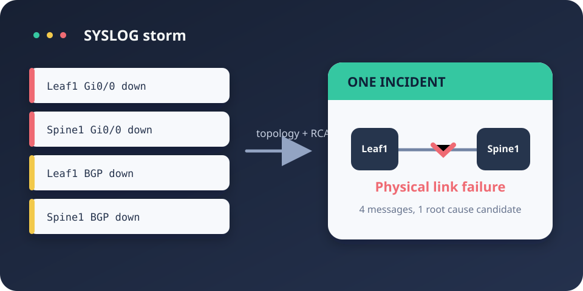
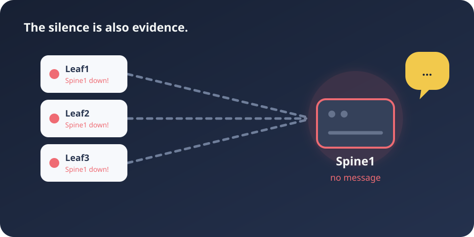
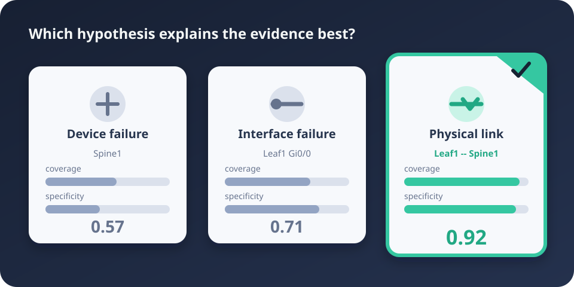
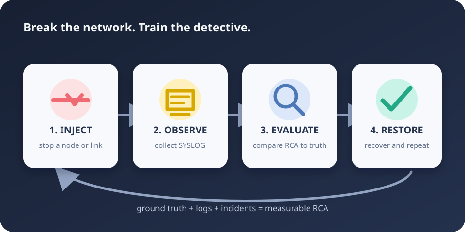

# （今さら?!）ネットワーク専用のSYSLOGサーバを作ってみた

<br>

（このページはAdvent Calendar 2026向けに記載したものです）

<br>

**ネットワークのトポロジー情報を使って「SYSLOGの群れ」から根本原因を探す**　というお話しです。

<br>

ネットワーク機器から、こんなSYSLOGメッセージが届いたとします。

```text
08:13:06 Leaf1  Interface Gi0/0 down
08:13:07 Spine1 Interface Gi0/0 down
08:13:08 Leaf1  BGP neighbor Spine1 down
08:13:08 Spine1 BGP neighbor Leaf1 down
```

4件のログ。4件の障害。

……ではないですよね。

実際には、Leaf1とSpine1をつなぐ**1本のケーブル**が抜けただけかもしれません。

一般的なSYSLOGサーバーが教えてくれるのは「何時何分に、どの機器が、何を言ったか」まで。

「で、結局どこが悪いの？」は、ログを見る人が考えます。

障害対応中に人がやることは、だいたいこんな感じです。

1. 大量の赤いログを眺める
2. 時刻が近いものを集める
3. 構成図を開く
4. 機器同士のつながりを頭の中でたどる
5. 「たぶんここ」と推理する

<p align="center">
  
</p>

つまり、SYSLOG監視には意外と**探偵業**が含まれているわけです。

SYSLOGだけを見るのではなく、**ネットワークの「つながり」も一緒に見れば、もう少し気の利いた推理が機械的にできるのでは？** という発想で作ってみたのが、[topology-syslog](https://github.com/takamitsu-iida/topology-syslog)です。

<br>

## そもそもSYSLOGって何？

SYSLOGは、サーバーやネットワーク機器が出す「ひとこと日記」のようなものです。

```text
インターフェースが落ちました
BGPの接続が切れました
ログインに失敗しました
温度が上がりました
```

こういう情報は障害調査には欠かせませんが、SYSLOG自身は基本的に**見たことを報告するだけ**です。

たとえば人間でいうと、

```text
Aさん「廊下の電気が消えた！」
Bさん「コピー機も止まった！」
Cさん「Wi-Fiも切れた！」
```

という証言が届くイメージです。

証言は3件ありますが、原因は「ビルのブレーカーが落ちた」の1件かもしれません。

この「複数の症状を、ひとつの原因としてまとめる」処理を　**RCA（Root Cause Analysis、根本原因分析）**　と呼びます。

<br>

> どうせ根本原因分析には生成AIを使うんだろう？
>
> と思われるかもしれませんが、いいえ、使ってません。
>
> 生成AIは、こんなインシデントが出たんだけど、関連する装置の状態を収集して詳細に調査して、という場面で使う方が効果的だと思います。

<br>

## topology-syslogがやること

topology-syslogは、ネットワークの構成情報を先に読み込んでおきます。

> 読み込ませるのは絵（構成図）ではなく、YANGモデルに準拠したYAML形式のファイルです

```text
       Spine1
       /    \
    Leaf1  Leaf2
```

この構成でSYSLOGメッセージが届いたら、単語だけを見るのではなく、次のような情報も使います。

- どの機器とどの機器がつながっているか
- そのリンク上にどのインターフェースやBGPセッションがあるか
- 周囲の機器が何を報告し、どんな順番で届いたか

そして、ばらばらのログを「**インシデント**」という単位にまとめます。

```text
これまで:
  Interface down!
  Interface down!
  BGP down!
  BGP down!

今回:
  根本原因の候補:
    Leaf1 -- Spine1 間の物理リンク障害

  影響:
    両端インターフェース down
    BGPセッション down
```

ログを減らしているのではありません。

**同じ出来事を別々の角度から見た証言として整理している**のがポイントです。

<br>

## 「犯人を即決しない」RCA（Root Cause Analysis）

このプロジェクトの一つの特徴は、最初のログだけで犯人を決めないところにあります。

たとえば最初に届いたのが、これだけだったとします。

```text
Leaf1: BGP neighbor Spine1 down
```

この時点では、いくつかの可能性があります。

- Leaf1自身に問題がある
- 対向しているSpine1に問題がある
- 間のリンクに問題がある
- BGPだけに問題がある
- たまたま一時的に切れた

推理材料が少ないので、断定は危険です。

その数秒後、追加のログが届きます。

```text
Leaf2: BGP neighbor Spine1 down
Leaf3: BGP neighbor Spine1 down
```

Leaf1、Leaf2、Leaf3が同時に同じ相手を見失っています。

ということは「3台のLeafが偶然同時に壊れた」よりも、「共通の接続先であるSpine1が止まった」と考える方が自然です。

```text
Leaf1 ─┐
Leaf2 ─┼─X─ Spine1
Leaf3 ─┘
```

しかも、肝心のSpine1自身は何も言っていません。

電源断した機器は　**「いま電源が切れました！」というログを送れない**　からです。

つまり「本人は無言なのに、周囲が全員その人を指さしている」状態です。

無言であることが、逆に重要な手がかりになります。ミステリーっぽくて、なかなか面白いところです。

<p align="center">
  
</p>

<br>

## 仮説を並べて、いちばん説明できるものを選ぶ

topology-syslogのRCAエンジンは、最初から答えをひとつに決めません。

まず、原因になりそうな候補（Hypothesis、仮説）を並べます。

```text
仮説A: Spine1の装置障害
仮説B: Leaf1のインターフェース障害
仮説C: Leaf1--Spine1間の物理リンク障害
```

次に、それぞれの仮説を採点します。

| 採点の観点 | ざっくり言うと |
|---|---|
| coverage | 何件のログをまとめて説明できる？ |
| specificity | 「装置全体」より「このリンク」と具体的に言える？ |
| direct evidence / temporal fit | 直接の証拠があり、時間の流れも自然？ |
| contradiction / redundancy | 復旧済みなどの矛盾や、残っている経路はない？ |
| link coherence | 複数の症状を、同じ物理リンクで説明できる？ |

数式を知らなくても、考え方はシンプルです。

**いちばん多くの証言を、いちばん無理なく説明できる仮説を選ぶ**、　それだけです。

<p align="center">
  
</p>

選ばれた原因だけでなく、採点理由も保存します。

そのため、画面やAPIから「なぜこのリンク障害を根本原因だと考えたのか」を確認できます。

システムが突然「犯人はSpine1です」と言い切るのではなく、証拠と採点結果を残す。
運用で使うなら、この説明可能性はかなり大切です。

監視システムも、最初の容疑者に固執すると誤認逮捕します。

<br>

## BGP downを「原因」にしない

ネットワーク監視では、`BGP down`はとても目立ちます。画面も赤くなります。

でも、BGPセッションが落ちたのは**結果**かもしれません。

```text
ケーブル断
  ↓
インターフェース down
  ↓
BGPセッション down
  ↓
経路が消える
```

火災報知器が鳴ったときに、「原因は火災報知器です」とは言いません。

同じように、topology-syslogではBGPセッションを主に「影響を受けたもの」として扱い、その上流にある装置・インターフェース・物理リンクを原因候補にします。

派手なログに飛びつかず、因果関係を一段さかのぼるわけです。

<br>

## ログは、きれいな順番では届かない

現実の分散システムでは、イベントが起きた順番と、サーバーに届く順番が同じとは限りません。

```text
実際の順番: 物理リンク down → BGP down
届いた順番: BGP down → 物理リンク down
```

ネットワーク遅延や機器の負荷で、あとから重要な証拠が届くことがあります。

そこでtopology-syslogは、短い時間窓に入ったログをまとめて再評価します。

新しい証拠でより良い仮説が見つかったら、**RCAの結果を改訂**します。

最初は「Leaf1周辺の障害」と推理していても、あとからSpine1側のインターフェースdownが届けば、「Leaf1--Spine1間の物理リンク障害」へ改訂します。

名探偵も、後半で新しい証拠が出れば推理を更新します。
監視システムも、最初の発言に意地を張らない方がよさそうです。

<br>

## 復旧にも「ちょっと待つ」

復旧ログが1件来た瞬間に「完全復旧！」とするのも危険です。

一方のインターフェースだけが上がった、再びすぐ落ちた、関連するBGPはまだ戻っていない、といったことがあるからです。

topology-syslogでは、障害の状態を段階的に扱います。

```text
ACTIVE（障害中） → DEGRADED（一部復旧） → RECOVERING（様子見） → RECOVERED
```

「直りました！」ではなく、
「直ったようです。30秒ほど静かなら、本当に直ったことにしましょう」と慎重に判断します。

<br>

## SYSLOGを読む前に、意味をそろえる

機器が出すログは種類が多いため、SYSLOG Knowledge Base（SKB）というルールで分類します。

- 障害の強い手がかり
- 周囲と合わせて判断する状態変化
- 既存インシデントを更新する復旧通知
- 保存はするが、RCAには使わないノイズ

何でも事件扱いすると監視画面は真っ赤になりますが、捨てると後で調べられません。
そこで「保存する」と「推理に使う」を分けています。全員を容疑者にしないための仕組みです。

<br>

## 全体像

処理の流れを一行でまとめると、次のようになります。

```text
SYSLOG → 意味を分類 → 証拠をまとめる → 仮説を採点 → インシデント発報
```

中心にいるのは、**トポロジーと観測事実を用いた仮説ベースのRCA**です。

この時点で、生成AIは使いません。

詳しいデータ構造や処理パイプラインは、[RCAの設計資料](README.hypothesis-rca.md)にまとめています。

<br>

## ちょっと動かしてみるには

自宅ネットワークの管理用に作ったSYSLOGサーバなので、正直なところ万能ではありません。ただ、動かすのは簡単で、Pythonさえあれば動きます。

ローカル環境では、次のコマンドで起動できます。

```bash
make setup
make start
```

起動すると、主に次のサービスが立ち上がります。

| サービス | URL |
|---|---|
| Web UI | <http://localhost:3000> |
| Node Monitor | <http://localhost:8090> |
| API | <http://localhost:8080> |

Web UIではインシデントと推理の根拠を確認でき、Node Monitorは装置がSYSLOGを送れる状態かを判断します。

APIは外部のインシデント管理システムとの連携に使います。

詳しいセットアップ、Docker Composeでの起動方法、API一覧は[通常のREADME](README.md)にまとめています。

<br>

## ラボの機器を使って強化訓練する

Cisco Modeling Labs（CML）上の検証ネットワークへ、ランダムに障害を注入して情報を収集するツールも用意しています。

- ノード停止
- リンク停止
- 復旧

そして1回の実験ごとに、

- 実際に止めた装置・リンク（正解ラベル）
- その間に届いたSYSLOG
- RCAが生成したインシデント
- 復旧時のログ

をJSON Lines形式で保存します。

```text
障害を注入 → ログを観測 → RCA結果を保存 → 復旧 → 再び観測
```

ネットワーク構築時には障害を起こしてSYSLOGを確認することがあります。

そのデータを一度きりで捨てず、「実際に止めた場所」という正解と一緒に集めれば、RCAの精度向上に使えます。

環境によって根本原因分析の精度は変わってしまうかもしれないので、こうしたチューニングも大切です。

<p align="center">
  
</p>

<br>

## 既存のSYSLOGを見るのに疲れたら

生のSYSLOGデータがあれば、topology-syslogに通して根本原因を推測し、少数のインシデントへ変換できます。

既存サーバを置き換えず、有事の際にRCAエンジンだけ使う方法です。

ログの海で泳ぎ疲れたときの、救命ボートくらいに考えるのがよいかもしれません。

<br>

## このプロジェクトを通してわかったこと

- **ログの文面だけでは足りない。** `BGP down`だけでは、原因がケーブルなのか対向装置なのか分かりません。
- **「誰が言っていないか」も情報になる。** 周囲が同じ装置を見失い、本人だけが無言なら、それも手がかりです。
- **答えだけでなく、理由が必要。** 採点内訳や証拠があれば、人間が推理の妥当性を確認できます。
- **後から訂正できる設計は強い。** ログは遅れ、欠け、順番も入れ替わるため、証拠の追加で結論を直せる方が現実的です。

<br>

## もちろん、万能ではない

ネットワークの構成情報が古ければ、推理も間違います。

未知のSYSLOGは正しく分類できないことがあります。複数障害が同時に起きれば、仮説の分離も難しくなります。

そして、RCAが出した答えはあくまで**根本原因の候補**です。

このプロジェクトが目指しているのは、人間を完全に追い出すことではありません。

```text
大量のログ
    ↓
人間が全部読む
```

を、

```text
大量のログ
    ↓
機械が証拠を整理して仮説を提示
    ↓
人間が理由を確認して判断
```

へ変えることです。

名探偵による完全自動化というより、**優秀な助手を監視チームにひとり追加する**イメージに近いかもしれません。

<br>

## おわりに

SYSLOGを1行ずつ眺めると、障害は大量にあるように見えます。

でも、ネットワークのつながりを重ねて見ると、

- このログとこのログは、同じリンクの両端から来ている
- 複数の機器が、同じ相手を見失っている
- BGP downは原因ではなく、その先にある影響らしい
- 復旧ログが来たが、まだ完全復旧とは言えない

といった「物語」が見えてきます。

**ログを集める箱から、ログの背景を推理するシステムへ。**

topology-syslogは、そんな監視の形を試しているプロジェクトです。

興味を持っていただけたら、ぜひリポジトリをのぞいてみてください。

- GitHub: [takamitsu-iida/topology-syslog](https://github.com/takamitsu-iida/topology-syslog)
- セットアップと機能一覧: [README.md](README.md)
- RCAの詳しい設計: [README.hypothesis-rca.md](README.hypothesis-rca.md)

<br><br>

ちなみに、ぼくは１行もコードを書いていません。すべてAIに作成していただきました。
